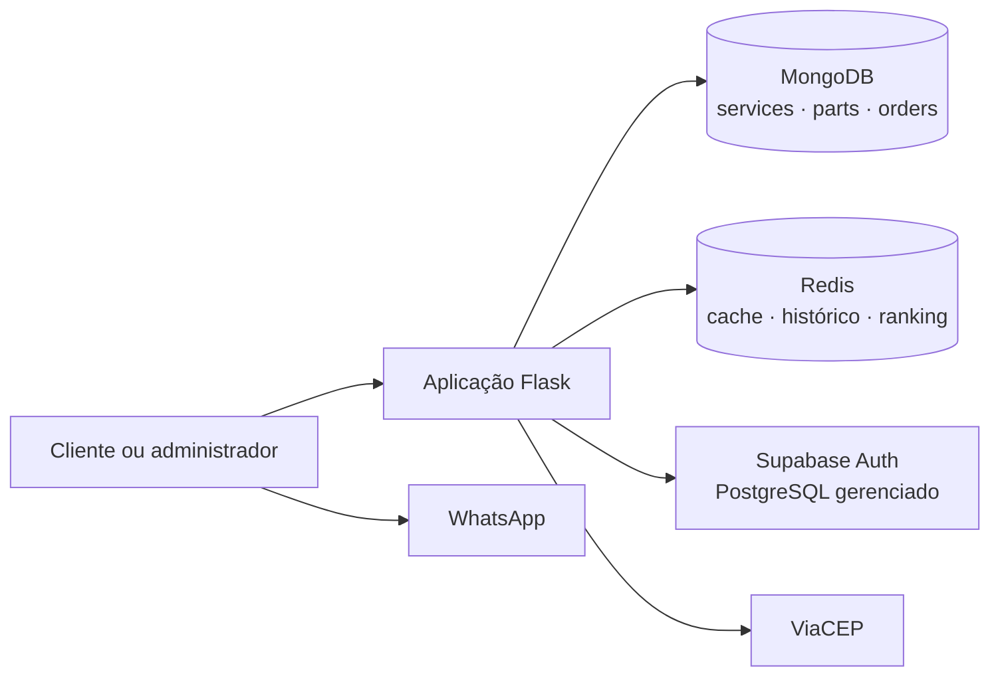
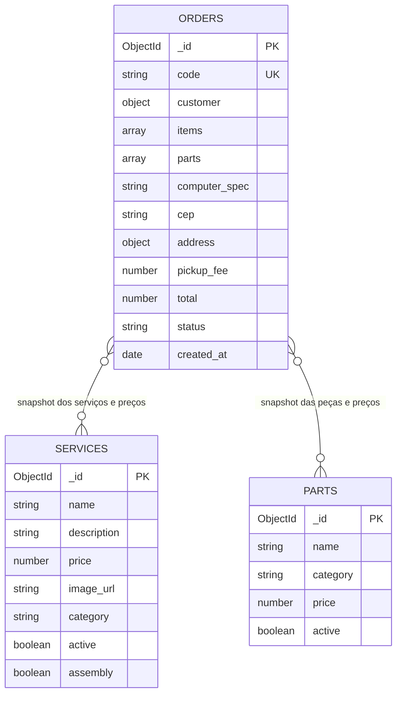

# 🖥️ ByteCare — assistência técnica para computadores

> E-commerce de serviços de informática com catálogo de manutenção, orçamento de montagem de computadores e acompanhamento de pedidos.

---

## 📋 Sobre o Projeto

O **ByteCare** é um projeto acadêmico desenvolvido em Python com Flask. Em vez de vender componentes em estoque, a loja vende serviços técnicos: limpeza, diagnóstico, manutenção, instalação, upgrades e montagem.

O cliente escolhe um ou mais serviços, informa o computador e o CEP, calcula uma estimativa de coleta e registra o pedido. A solicitação é armazenada e, ao final, o sistema abre uma conversa no WhatsApp com os detalhes do orçamento. A equipe administra o catálogo e atualiza o andamento dos pedidos em um painel protegido pelo Supabase Auth.

O projeto demonstra persistência poliglota:

- **MongoDB** armazena serviços, peças de montagem e pedidos como documentos.
- **Redis** guarda cache do catálogo, histórico de serviços visualizados e ranking de popularidade.
- **Supabase Auth** autentica os administradores. A aplicação não cria tabelas próprias no PostgreSQL.

---

## 🏗️ Arquitetura e Modelo de Dados



### Documentos do MongoDB



Os pedidos guardam cópias dos nomes e preços selecionados no momento da solicitação. Assim, alterações posteriores no catálogo não mudam o histórico do pedido. O Redis é uma camada de cache e não substitui a persistência do MongoDB.

---

## 📁 Estrutura do Projeto

```text
Ecomerce/
├── app.py                         # ponto de entrada Flask/Gunicorn
├── bytecare/
│   ├── __init__.py                # application factory e registro das rotas
│   ├── config.py                  # leitura das configurações de ambiente
│   ├── extensions.py              # inicialização MongoDB e Redis
│   ├── admin/
│   │   ├── routes.py              # login, painel e operações administrativas
│   │   └── service.py              # regras do painel e atualização de pedidos
│   ├── catalog/
│   │   ├── repository.py          # consultas e gravações no MongoDB
│   │   ├── routes.py              # loja, detalhes e busca de componentes
│   │   └── service.py             # cache Redis e catálogo
│   ├── common/
│   │   ├── auth.py                # verificação da sessão administrativa
│   │   ├── database.py            # verificação de disponibilidade MongoDB
│   │   └── filters.py             # formatação de valores e datas
│   ├── data/
│   │   └── catalog_seed.py        # catálogo inicial de demonstração
│   ├── infrastructure/
│   │   └── supabase_auth.py       # adaptador do Supabase Auth
│   └── orders/
│       ├── repository.py          # persistência de pedidos no MongoDB
│       ├── routes.py              # CEP, criação e acompanhamento de pedidos
│       └── service.py             # validações, frete e mensagem WhatsApp
├── templates/                     # páginas HTML renderizadas pelo Jinja
├── static/                        # CSS e JavaScript do navegador
├── Dockerfile
├── docker-compose.yml             # aplicação, MongoDB e Redis
├── requirements.txt
├── .env.example                    # exemplo de configuração local
└── .gitignore
```

O código segue um **monólito modular**: uma aplicação Flask organizada por módulos, com rotas, regras de negócio e repositórios separados.

---

## 🧩 Módulos e Rotas

### `catalog` — loja e catálogo

| Rota | Método | Descrição |
|---|---|---|
| `/` | GET | Exibe catálogo, busca, categorias, recomendações e status do cache |
| `/servicos/<sid>` | GET | Exibe detalhes de um serviço e registra a visualização recente no Redis |
| `/api/pecas?q=<termo>` | GET | Pesquisa componentes cadastrados para orçamentos de montagem |

### `orders` — orçamento e acompanhamento

| Rota | Método | Descrição |
|---|---|---|
| `/api/cep/<cep>` | GET | Consulta o endereço via ViaCEP e calcula estimativa de coleta |
| `/api/pedidos` | POST | Valida e grava um pedido no MongoDB; retorna o link de WhatsApp |
| `/acompanhar` | GET/POST | Busca o pedido pelo código e mostra status e detalhes |

### `admin` — painel restrito

| Rota | Método | Descrição |
|---|---|---|
| `/admin/login` | GET/POST | Exibe o login e autentica usando Supabase Auth |
| `/admin` | GET | Mostra catálogo, pedidos recentes e estado do Redis |
| `/admin/servicos` | POST | Cadastra ou atualiza um serviço no MongoDB |
| `/admin/servicos/<sid>/excluir` | POST | Exclui um serviço do catálogo |
| `/admin/pedidos/<oid>/status` | POST | Atualiza o status de um pedido no MongoDB |
| `/admin/sair` | POST | Encerra a sessão administrativa |

---

## ⚙️ Regras de Negócio

| Regra | Descrição |
|---|---|
| **Catálogo** | O item comercial é um serviço técnico armazenado na collection `services`. |
| **Carrinho** | Aceita vários serviços e quantidades; os preços são lidos novamente do MongoDB no servidor ao criar o pedido. |
| **Peças para montagem** | O cliente pode informar peças que já possui. Peças cobradas são opcionais e permitidas em serviços marcados como montagem. |
| **CEP e coleta** | O endereço é consultado no ViaCEP. A estimativa usa uma tabela demonstrativa por UF com origem em Teresina (PI). |
| **Pedido** | O pedido é persistido no MongoDB antes de retornar o link `wa.me` com os dados da solicitação. |
| **Status** | A equipe pode usar Recebido, Em análise, Aguardando aprovação, Em manutenção, Pronto, Concluído ou Cancelado. |
| **Cache** | O catálogo filtrado usa Redis com TTL configurável e invalidação após alterações administrativas. Se Redis estiver indisponível, o catálogo consulta o MongoDB. |
| **Histórico e popularidade** | Redis registra os serviços vistos recentemente e mantém um ranking dos serviços solicitados. |
| **Persistência** | O volume Docker `mongo_data` preserva os documentos entre reinicializações; `redis_data` persiste os dados Redis. |

---

## 🛠️ Tecnologias


---

## 🚀 Como Executar

O modo recomendado usa Docker Compose para executar a aplicação, MongoDB e Redis localmente.

### Pré-requisitos

- [Docker](https://www.docker.com/) com Docker Compose
- Conta Supabase e usuário administrador para acessar o painel

### Passos

```bash
# Clone o repositório
git clone <url-do-repositorio>

# Entre na pasta do projeto
cd Ecomerce

# Crie seu arquivo local de configuração
cp .env.example .env
```

Configure `SUPABASE_URL`, `SUPABASE_KEY` e `WHATSAPP_NUMBER` no `.env`. Para criar o administrador, abra o projeto Supabase e acesse **Authentication → Users → Add user**.

Suba a aplicação e os bancos:

```bash
docker compose up --build
```

Abra **http://localhost:5000**. O catálogo público fica na página inicial e o painel administrativo em **/admin**. A URI padrão do Compose usa `mongodb://mongo:27017`; nesse contexto, `mongo` é o nome do serviço na rede interna do Docker.

### Portas

| Serviço | Porta do container | Porta na máquina |
|---|---:|---:|
| ByteCare | `5000` | `5000` |
| MongoDB | `27017` | `27017` |
| Redis | `6379` | sem porta publicada |

### Persistência e encerramento

MongoDB e Redis mantêm dados nos volumes `mongo_data` e `redis_data`. Para parar os containers mantendo os dados:

```bash
docker compose down
```

Não use `docker compose down -v` se quiser preservar esses dados: a opção `-v` remove os volumes.

### Variáveis de ambiente

| Variável | Finalidade |
|---|---|
| `MONGO_URI` | URI de conexão MongoDB. Padrão Docker local: `mongodb://mongo:27017`. |
| `MONGO_DB` | Nome do banco MongoDB. Padrão: `Ecomerce`. |
| `REDIS_URL` | URI Redis. No Compose, a aplicação usa o serviço `redis`. |
| `SUPABASE_URL` | Project URL do Supabase. |
| `SUPABASE_KEY` | Chave publishable/anon usada pelo Supabase Auth. |
| `SECRET_KEY` | Chave Flask para assinatura da sessão. Troque antes de qualquer implantação pública. |
| `WHATSAPP_NUMBER` | Telefone em formato internacional, somente dígitos. |
| `CATALOG_CACHE_TTL_SECONDS` | Tempo de cache do catálogo; padrão: 300 segundos. |
| `LOG_LEVEL` | Nível dos logs da aplicação; padrão: `INFO`. |

O arquivo `.env` contém credenciais e é ignorado pelo Git. Nunca publique as chaves reais.

---

## ☁️ Usar MongoDB Atlas

O projeto também pode apontar para um cluster Atlas:

1. Crie um cluster e um usuário de banco de dados no MongoDB Atlas.
2. Em **Network Access**, permita o IP da máquina que executa o Docker.
3. Copie a connection string SRV em **Connect → Drivers**.
4. Defina `MONGO_URI` no `.env` com essa string. Codifique caracteres especiais da senha para URL, como `@` para `%40`.
5. Reinicie a aplicação com `docker compose up --build`.

Quando `MONGO_URI` aponta para o Atlas, os documentos ficam no Atlas. O Compose ainda sobe o container MongoDB local por causa da configuração de dependências, mas a aplicação não o usa. Para retornar ao banco local, defina `MONGO_URI=mongodb://mongo:27017`.

---

## 🗃️ Bancos, Collections e Chaves

### MongoDB

- Banco: `Ecomerce`.
- `services`: serviços disponíveis, nome, descrição, preço, imagem, categoria e dados de exibição.
- `parts`: componentes usados opcionalmente em orçamentos de montagem.
- `orders`: dados do cliente, itens, preços registrados, computador, CEP/endereço, frete, total, status e data.

As collections e os documentos iniciais são criados pela aplicação conforme necessário; não é preciso criá-los manualmente.

### Redis

- `bytecare:catalog:*`: listas do catálogo em cache, com TTL configurável.
- `bytecare:recently_viewed:<visitor_id>`: até oito serviços vistos recentemente por visitante, com expiração de 30 dias.
- `bytecare:popular_services`: ranking e contagem de pedidos por serviço.

### Supabase Auth

O Supabase autentica os administradores por e-mail e senha. O projeto usa o serviço Supabase Auth e não requer tabelas próprias no PostgreSQL. Cadastre o usuário no painel Supabase em **Authentication → Users**.

---

## 💳 Pagamentos e Próximas Etapas

O fluxo atual registra o pedido e abre o WhatsApp com a solicitação formatada. Ele **não processa pagamentos** via PIX ou cartão e não possui implantação pública. O frete também é uma estimativa demonstrativa por UF, não uma cotação de transportadora.

---

## 🎬 Demonstração

O projeto está preparado para apresentação local: catálogo, carrinho, criação e acompanhamento de pedidos, painel administrativo e persistência nos serviços de dados configurados.<br>
Link do video de demonstração do codigo: https://drive.google.com/file/d/1enA7W9Frtygilp8IWGmY-DMa_-2Xw0qV/view?usp=sharing
